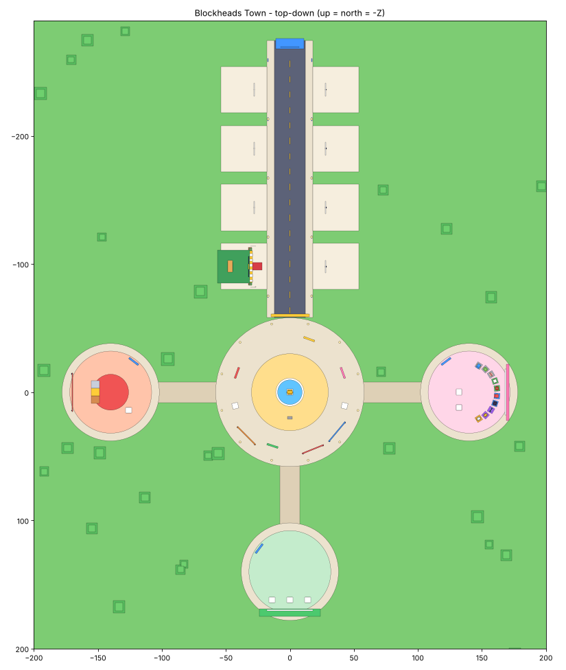

# Blockheads: Hustle & Collect

A multiplayer Roblox business simulator. Run a shop on Business Street, serve NPC
customers, upgrade from a lemonade stand to a restaurant, collect Blockheads
characters and compete in the server-wide **Customer Rush**.

Everything is code: the town, shops, NPCs and UI are generated by scripts, so there is
no hand-built map to maintain and no asset IDs are required.



## Play it in 2 minutes (no tools needed)

1. Download `build/Blockheads.rbxlx` from this repository.
2. Open it in **Roblox Studio** (double-click, or File > Open from File).
3. Press **Play** (F5).

You spawn in the plaza. Follow the yellow beam to your shop on Business Street,
stand behind the counter and hold **E** (or tap and hold the Serve button on mobile).

Without publishing, progress is kept only for that play session (the game detects
that DataStores are unavailable in Studio and uses temporary in-memory data).

### Before you publish

- **File > Publish to Roblox**.
- **Game Settings > Security > Enable Studio Access to API Services**: ON (so saving works in Studio).
- **Game Settings > Places > (your place) > Maximum Players: 8** (there are 8 shop plots).
- Test with **Test > Start (2+ players)** to see multiplayer.

## Editing workflow with Claude Code (Rojo)

The `.luau` files in `src/` are the source of truth. To push edits into Studio live:

1. Install [Rojo](https://rojo.space) 7.x and the **Rojo plugin** in Studio.
2. In this folder run `rojo serve`.
3. In Studio: Plugins > Rojo > **Connect**. Saved file changes now appear in Studio.

Or rebuild the place file at any time: `rojo build -o build/Blockheads.rbxlx`.

Rojo and its Studio plugin are the only tools needed. `selene` (lint) and `lune`
(tests) are optional.

## Where everything lives in Studio

| Studio location | Source folder | What it is |
| --- | --- | --- |
| `ReplicatedStorage.Shared.Config` | `src/shared/Config` | All tuning numbers: prices, upgrades, customers, characters, rush, quests, colours |
| `ReplicatedStorage.Shared.Modules` | `src/shared/Modules` | Formulas, number formatting, the blocky character builder |
| `ReplicatedStorage.Assets.Characters` | (empty folder) | Drop your real character models here (see below) |
| `ServerScriptService.Server.Main` | `src/server/Main.server.luau` | Server entry point (Script) |
| `ServerScriptService.Server.Services` | `src/server/Services` | One ModuleScript per system (data, economy, plots, customers, rush, ...) |
| `ServerScriptService.Server.World` | `src/server/World` | Town and shop builders |
| `StarterPlayer.StarterPlayerScripts.Client.Main` | `src/client/Main.client.luau` | Client entry point (LocalScript) |
| `...Client.Controllers` | `src/client/Controllers` | HUD, NPC rendering, effects, tutorial |
| `...Client.UI` | `src/client/UI` | UI kit and panels |

Created at runtime (do not add these by hand): `ReplicatedStorage.Remotes`,
`Workspace.Town`, `Workspace.ShopPlots`, `Workspace.NPCs`, and the `BlockheadsUI`
ScreenGui in each player's PlayerGui (this replaces hand-made StarterGui screens).

## What is in the game

- **Town**: Main Plaza (spawn, welcome/events/Top Tycoons boards, daily kiosks, portals),
  Business Street (8 plots), Character Center, Competition Arena, Upgrade District.
- **Business loop**: customers arrive at bus stops, queue, order, lose patience, pay.
  Hold to serve. Combos and fast-service tips reward good play.
- **5 businesses, 21 products**, each product with 10 levels.
- **6 upgrades**: speed, quality, queue, staff (auto-serve into a cash register),
  register storage, curb appeal (visible decorations, more Rich/VIP customers).
- **6 customer types**: Normal, Impatient, Hungry, Rich, VIP, and visiting Blockheads.
- **10 collectible characters** (placeholders) with rarities and small bonuses, unlocked
  by coins, befriending visitors, or achievements. Team of up to 3 stands in your shop.
- **Customer Rush**: every 4-6 minutes, 75 seconds, same customer sequence for every
  shop, live scores, coin prizes for the top 3, exclusive Gold awning for 1st.
- **Retention**: 7-day login streak, 3 daily quests, global all-time leaderboard.
- **Saving**: DataStore with session locking, retries, versioned data, autosave,
  save on leave and on shutdown. A failed load kicks the player instead of risking
  an overwrite.
- **No monetization** yet, by design. No Robux purchases, no paid random rewards.

## Tuning the game

Edit the files in `src/shared/Config`:

| File | Controls |
| --- | --- |
| `GameConfig.luau` | Spawn rate, queue size, combo, tips, XP curve, autosave |
| `Products.luau` | Prices, production times, demand, unlock costs |
| `Businesses.luau` | Business tiers and unlock costs |
| `Upgrades.luau` | Upgrade costs, max levels, effect per level |
| `Customers.luau` | Customer types, patience, pay, rush points |
| `Characters.luau` | The cast: names, rarity, bonus, how to unlock, look |
| `Rush.luau` | Rush timing, intensity and prizes |
| `Quests.luau` | Daily quest pool and login rewards |
| `Cosmetics.luau` | Awning styles |
| `Theme.luau` | UI colours, fonts, sounds, music |

## Using your real Blockheads characters

The ten characters in `Characters.luau` are **placeholders**. To replace them:

1. Edit the names, descriptions, personalities and `Look` colours in `Characters.luau`.
   Keep each `Id` unchanged once real players have saves.
2. Optional, for real models: put a Model in `ReplicatedStorage > Assets > Characters`
   named exactly like the character `Id` (for example `Brix`), with a PrimaryPart and
   its pivot at the feet. That model is then used in shops and the Character Center.
   The UI portrait and the visiting-customer version still use the simple `Look`.

## Testing checklist (in Studio)

1. **Join**: you spawn in the plaza; a HUD with coins, level and menu buttons appears;
   one plot on Business Street shows "YOUR SHOP" and your name on its sign.
2. **Serve**: customers walk to your counter with an order bubble; holding Serve pays
   coins with a "+coins" popup; the hint line advances through the 3 tutorial steps.
3. **Upgrade**: Upgrades > Faster Hands costs 25; Shop > add Strawberry Lemonade (75).
4. **Characters**: Collection lists 10 Blockheads; buy Lemmy (750); Team tab equips.
5. **Rush**: wait for the first rush (2.5 minutes), or in Studio select `Workspace` in
   the *server* view and tick the `ForceRush` attribute. Banner, timer and scores
   appear; prizes arrive when it ends.
6. **Saving** (published place with API access on): stop and start again; coins,
   upgrades and characters are still there.
7. **Multiplayer**: Test > Start with 2 players; each gets a different plot and only
   the owner can serve at a shop.

## Automated checks

```
rojo build -o build/Blockheads.rbxlx
lune run tests/run.luau      # 113 checks, about 90 seconds
selene src                   # lint
```

`tests/run.luau` runs the real server and client code headlessly (via Lune) with fake
players: world generation, plot ownership, serving, anti-exploit checks, purchases,
characters, quests, staff, a full Customer Rush, saving/rejoining, DataStore outage
and session-lock safety, and opening every UI panel. It validates property names and
types against the Roblox API, but it is **not** Roblox: how things look, feel, sound
and perform on a device still needs a play test in Studio.

## Not done yet

- Background music and custom sounds (needs audio asset IDs; see `Theme.luau`).
  Current sound effects are built-in Roblox client sounds used as placeholders.
- Real Blockheads art (see above) and character animations beyond the walk bob.
- Weekly competitions, seasonal events, prestige, trading, decorations, monetization.
- Game icon, thumbnails and store page.
