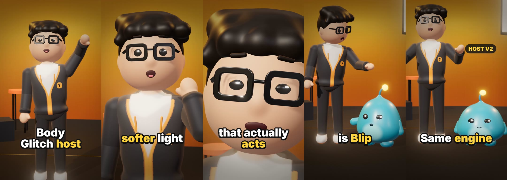

# Body Glitch character kit v2

A new host, a sidekick, a studio set and a motion kit for the Deep Dive 3D engine that Body Glitch videos are built
with. Everything is code (three.js + SDF sculpting), same as before: no AI images, no new dependencies.



Demo: [`preview/host-v2-demo.mp4`](preview/host-v2-demo.mp4) (15 s, 1080x1920, 30 fps, music and effects only).

## What changed

| | before | v2 |
|---|---|---|
| Host | default sculpt with a face mesh | vinyl-toy proportions (big smooth head, small body), swept hair, real glasses, open hoodie with trim, drawstrings and a badge |
| Face | eyelids only | eyes, brows, mouth and smile are rigged: `lid`, `look`, `brow`, `mouth`, `smile` |
| Motion | joints lerped between poses | anticipation, overshoot, overlap (head and forearms arrive late), squash and stretch, breathing, blinking, eye drift, lip flap from the word timings |
| Sidekick | none | Blip, a glossy cell with a glowing antenna that hops, squashes and waves |
| Set | kitchen | dark glossy studio with one glowing backdrop and coloured rim light |
| Frame rate | 24 fps | 30 fps recommended (`FPS=30`) |

## Install into a Body Glitch project

1. Copy `src/core/host.js`, `src/core/motion.js` and `src/core/studio.js` into the project's `src/core/`.
   Nothing existing is replaced; `human.js`, `sets.js` and the x-ray shots keep working.
2. In `src/shots.js`:

```js
import { Host, Buddy } from './core/host.js';
import { studio } from './core/studio.js';
import { track, drag, alive, breathe, mouthFor, hop, spring, bump, wobble, blink } from './core/motion.js';

const ST = studio(E, { tint: '#FFB21F', tint2: '#FF6A2B' });     // any two colours
const host = new Host({});                                       // hoodie, trim, tee, pants, shoes, skin, hair, badge
const blip = new Buddy({});                                      // color, belly, glow, scale
ST.scene.add(host.group, blip.group);
```

`Host` takes the same `pose()` joints as `Human` and has the same `.spine`, `.hips`, `.parts[0]` and
`setBodyMaterial()`, so it can replace the host in existing shots. He is 1.58 m tall: face at y 1.35, chest at y 1.0
(the old body was 1.8 m, so cameras aimed at the old face need to come down about 0.33).

3. Render at full quality and 30 fps: `FPS=30 node tools/capture.mjs video renders/<name>.mp4`.

`example-shots.js` + `example-script.json` are the demo above; they show every pattern below in context.

## Acting with the motion kit

```js
// keyframed acting: each key pulls the pose toward itself over d seconds, with overshoot by default
const act = track([
  { t: 0,    pose: { ...REST } },
  { t: 0.6,  d: 0.22, ease: eio, pose: { ...REST, spine: [4, 0, -3], squash: -0.05 } },          // dip first (anticipation)
  { t: 0.82, d: 0.55, pose: { ...REST, shR: [10, 0, 142], elR: 62, brow: [0.8, 0], smile: 1 } }, // then the wave
]);
// in draw(): overlap + life + lip flap for narration line 0
host.pose(alive(drag(act, lt), t, { talk: mouthFor(t, 0) })); breathe(host, t);
```

- `track(keys)` keyframes, `drag(act, t)` makes the head, forearms and brows arrive a few frames late.
- `alive(pose, t, { talk })` adds breathing sway, head drift, eye darts, blinks and talking.
- `spring`, `antic`, `bump`, `wobble`, `popIn` are the easings; use `spring` for anything that arrives.
- `hop(lt, { x0, x1, h })` returns `{ x, y, squash, air, land }` for a crouch, jump, landing squash and jiggle.
- Face: `lid` (-0.4 wide, 1 closed), `look [x, y]`, `brow [raise, tilt]` or `{ L, R }`, `mouth` 0..1, `smile` -1..1.
- Squash and stretch: `squash` on the whole body, `headSquash` on the head (volume is kept).

## Blip

```js
const h = hop(lt - 0.1, { x0: 1.5, x1: 0.33, h: 0.4 });
blip.group.position.x = h.x;
blip.set({ y: h.y, squash: h.squash, armL: 14 + h.air * 120, mouth: h.air, lean: h.land > 0 ? wobble(h.land / 0.9, 2.4, 3.5) * 34 : -h.air * 24 });
```

Keep Blip's face above the caption zone: in a two-shot aim the camera at about y 0.6 so he sits in the middle third.
